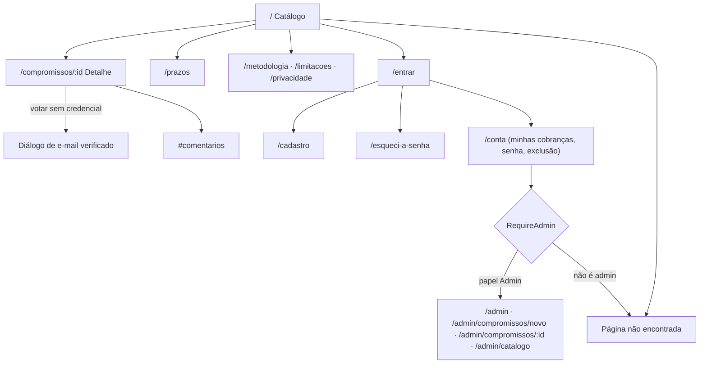
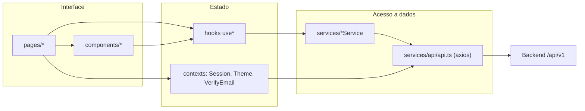
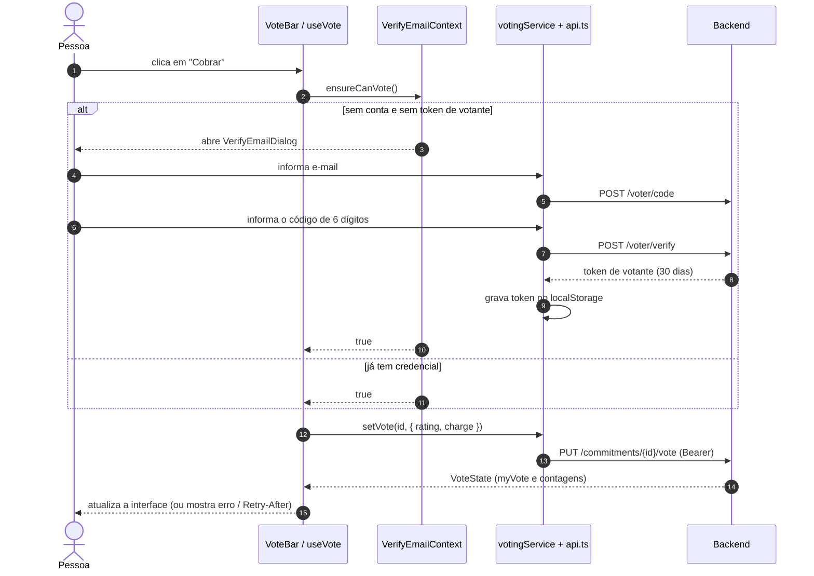

# Cobrança Cidadã — Frontend


*Imagem de compartilhamento do projeto (`public/og-image.png`, fonte em `design/og-image.svg`).*

**Prometeu. Cumpriu? Cobre.** SPA em React que mostra, uma a uma, as promessas de campanha do presidente Lula (mandato 2027–2030), com fonte pública, página do plano e situação de execução. É um **site de cidadãos, sem vínculo com o governo**: o visual segue o Padrão Digital de Governo (gov.br), mas **sem usar a marca, o brasão ou os selos oficiais**.


> Repositório irmão: [cobranca-cidada-backend](https://github.com/luispizzilopes/cobranca-cidada-backend). Para subir tudo com um comando, use o `docker compose up --build` da raiz do monorepo local.

## Índice

- [Apresentação](#apresentação)
- [Funcionalidades](#funcionalidades)
- [Stack tecnológica](#stack-tecnológica)
- [Arquitetura e organização do código](#arquitetura-e-organização-do-código)
- [Integração com o backend](#integração-com-o-backend)
- [Instalação e execução](#instalação-e-execução)
- [Testes e qualidade](#testes-e-qualidade)
- [SEO](#seo)
- [Produção](#produção)
- [Executando com o backend](#executando-com-o-backend)
- [Regras do projeto](#regras-do-projeto)

## Apresentação

**Problema:** promessas de campanha são numerosas, espalhadas em documentos e raramente acompanhadas depois da eleição. O site organiza 163 compromissos (carga inicial) com fonte e situação de execução, permitindo filtrar, consultar prazos e dar opinião.

**Público-alvo:** cidadãos que querem consultar o que foi prometido, ver prazos e registrar opinião; e curadores/administradores que mantêm o conteúdo no painel `/admin`.

Princípios que a interface respeita (detalhados em [Regras do projeto](#regras-do-projeto)):

- **Situação de execução é editorial; voto é opinião.** O voto aparece separado da situação, sempre com o rótulo "Opinião de pessoas com e-mail verificado. Não é pesquisa estatística."
- **Os compromissos vêm só da API.** Não há lista de compromissos no código.
- **Cor nunca é o único sinal:** a situação sempre vem acompanhada de texto.
- Aviso fixo "Site de cidadãos, sem vínculo com o governo." (`IndependentBanner`).

## Funcionalidades

| Funcionalidade | Rota | Como funciona para a pessoa | Onde está no código | API usada |
|---|---|---|---|---|
| **Catálogo** | `/` | Busca, filtros (área, origem, situação, com prazo), ordenação e paginação; filtros ficam na URL | `pages/catalog` (`CatalogPage`, `useCatalogFilters`), `useCommitments` | `GET /commitments`, `GET /catalog` |
| **Mais cobradas e comentários recentes** | `/` | Painéis com os itens mais cobrados e os últimos comentários | `MostChargedPanel`, `RecentCommentsPanel` | `GET /commitments?sort=mais-cobradas`, `GET /comments/recent` |
| **Detalhe do compromisso** | `/compromissos/:id` | Descrição, fontes, página do plano, histórico de situação, votos e comentários | `pages/commitment`, `useCommitment` | `GET /commitments/{id}` |
| **Voto** | detalhe e cartões | "Cobrar" e "Boa/Má proposta"; trocar e desfazer. Sem conta, pede e-mail e código na hora | `components/voting` (`VoteBar`, `VerifyEmailDialog`), `useVote` | `PUT/DELETE /commitments/{id}/vote`, `POST /voter/code`, `POST /voter/verify` |
| **Comentários** | `/compromissos/:id#comentarios` | Opinião em texto, respostas, apagar o próprio comentário | `components/comments`, `useComments` | `GET/POST /commitments/{id}/comments`, `DELETE /comments/{id}` |
| **Prazos** | `/prazos` | Linha do tempo agrupada pelo primeiro ano citado no texto do prazo | `pages/deadlines`, `utils/deadlines` | reaproveita a listagem |
| **Conta** | `/entrar`, `/cadastro`, `/esqueci-a-senha`, `/conta` | Cadastro com código por e-mail, login (senha ou Google), recuperação de senha, trocar senha, "minhas cobranças", exportar/apagar votos, excluir conta | `pages/auth`, `pages/account`, `contexts/SessionContext` | `/authentication/*`, `GET/DELETE /votes/mine` |
| **Login com Google** | telas de login/cadastro | Botão oficial do Google Identity Services; só aparece com `VITE_GOOGLE_CLIENT_ID` | `components/auth` | `POST /authentication/google` |
| **Conteúdo** | `/metodologia`, `/limitacoes`, `/privacidade` | Páginas em Markdown escritas à mão | `pages/content`, `src/content/*.md` | — |
| **Painel de curadoria** | `/admin/*` | Listar/criar/editar compromissos (com motivo), registrar situação, publicar, renomear áreas/origens | `pages/admin`, `RequireAdmin` | `/admin/*` |

O painel carrega **sob demanda** (`lazy`) e só aparece para contas com o papel `Admin`; a proteção real é da API.

### Mapa de navegação



## Stack tecnológica

| Tecnologia | Para que serve neste projeto |
|---|---|
| [React 19](https://react.dev/) + [TypeScript](https://www.typescriptlang.org/) | Interface em componentes com tipagem estática |
| [Vite 8](https://vite.dev/) | Servidor de desenvolvimento (porta 5173) e build; o plugin `vite-seo-plugin.ts` gera um HTML por rota estática |
| [react-router-dom 7](https://reactrouter.com/) | Roteamento (`createBrowserRouter`), rotas aninhadas e carregamento sob demanda do painel |
| [styled-components 6](https://styled-components.com/) | Estilos em CSS-in-JS, um `*.styles.ts` por componente; tokens claro/escuro em `globalStyle.ts` |
| [axios](https://axios-http.com/) | Cliente HTTP com interceptores de credencial e renovação de sessão (`services/api/api.ts`) |
| [react-markdown](https://github.com/remarkjs/react-markdown) + [remark-gfm](https://github.com/remarkjs/remark-gfm) | Renderização das páginas de conteúdo |
| [lucide-react](https://lucide.dev/) | Ícones |
| [rawline-webfont](https://www.npmjs.com/package/rawline-webfont) | Fonte Rawline (licença OFL), servida pelo próprio site |
| [Vitest](https://vitest.dev/) + [Testing Library](https://testing-library.com/) | Testes de unidade/componentes (ambiente `jsdom`) |
| [Playwright](https://playwright.dev/) + [axe-core](https://github.com/dequelabs/axe-core-npm) | Testes ponta a ponta e de acessibilidade |
| [oxlint](https://oxc.rs/docs/guide/usage/linter) · [Prettier](https://prettier.io/) | Lint e formatação (`singleQuote`, `printWidth: 100`) |
| nginx (imagem Docker) | Servir o build, cabeçalhos de segurança/CSP e SEO por SSI |

Não há biblioteca de gerenciamento de estado global nem de formulários: o estado vive em **Context API** e **hooks próprios** (sem TanStack Query, por decisão registrada em `docs/decisoes.md`, D1).

## Arquitetura e organização do código

```
src/
├── components/
│   ├── common/        Button, Input, Select, Alert, Badge, Modal, Pagination, Toast, Logo... (barrel em index.ts)
│   ├── layout/        AppLayout, Header, Footer, IndependentBanner, Page, AuthCard, RequireAdmin
│   ├── auth/          GoogleSignInButton, GoogleAuthSection, googleIdentity
│   ├── comments/      CommentsSection
│   └── voting/        CommitmentCard, VoteBar, Countdown, VerifyEmailDialog
├── contexts/          ThemeContext, SessionContext, VerifyEmailContext
├── content/           Markdown das páginas de conteúdo (metodologia, limitações, privacidade)
├── data/              domains (URL da API), site (nome, menu), statusMeta (cor por situação)
├── hooks/             useCommitments, useCommitment, useCatalog, useMyVotes, useVote, useComments, usePageTitle...
├── pages/             uma pasta por rota: catalog, commitment, deadlines, auth, account, content, admin, notFound
├── routes/            router.tsx (mapa de rotas), AppRoutes.tsx
├── seo/               pages (SEO por rota), headTags, applySeo
├── services/          api/api.ts (axios + credenciais), commitment, catalog, auth, voting, comment, admin, types.ts
├── utils/             apiError, dates, deadlines, password, download
├── globalStyle.ts     tokens de tema (claro/escuro), foco, reduced motion
├── App.tsx            ThemeProvider → ToastProvider → ErrorBoundary → SessionProvider → rotas
└── main.tsx
e2e/                   specs Playwright (account, admin, catalog, voting) e helpers
design/                og-image.svg (fonte da imagem de compartilhamento)
vite-seo-plugin.ts · nginx.conf.template · Dockerfile
```

**Convenções** (`CLAUDE.md`): componente em PascalCase em pasta própria; estilos em `<Componente>.styles.ts`; hooks `use*`; services como objeto literal com sufixo `Service`; rotas públicas em português; textos em português do Brasil.

### Diagrama de arquitetura



Fluxo de dados: **página → hook `use*` → service → `api.ts` → API**. Páginas não chamam services de dados diretamente quando existe hook. Os filtros do catálogo ficam na URL (`useCatalogFilters`), não em estado global.

### Fluxo: votar em um compromisso

O voto exige credencial. Se a pessoa não tem conta nem e-mail verificado, o diálogo de verificação abre, e o voto original é aplicado assim que o código é confirmado.



## Integração com o backend

- **URL base:** `VITE_API_URL` (padrão `http://localhost:5399`), lida em `src/data/domains.ts`. Todas as rotas usam o prefixo `/api/v1`. Valores `VITE_*` são **embutidos no bundle em tempo de build**.
- **Cliente:** instância axios com `withCredentials: true` (necessário para o cookie de refresh).

### Credenciais e sessão (`services/api/api.ts`)

| Credencial | Onde fica | Duração | O que permite |
|---|---|---|---|
| **Conta** | token de acesso **só em memória** | curto; renovado pelo cookie HttpOnly `/authentication/refresh` | tudo, inclusive perfil e (com papel Admin) painel |
| **Votante** (e-mail verificado, sem conta) | `localStorage` | 30 dias, sem refresh | só votar, comentar e gerir os próprios votos |

- O interceptor de requisição anexa o token de conta ou, na falta dele, o de votante.
- Em `401` com token de conta, tenta **uma única renovação** (`restoreSession`, com `navigator.locks` para evitar corridas entre abas) e repete a requisição; com token de votante, descarta o token.
- Só tenta restaurar a sessão se já houve login neste navegador (uma dica em `localStorage`).
- Login de conta substitui o token de votante. `localStorage` guarda apenas: tema, usuário (id, nome, e-mail, papéis), token de votante e a dica de sessão.
- `SessionContext` expõe `kind` (`account` | `voter` | `anonymous`), `canVote`, `isAdmin` e `ready`.

### Erros

`extractApiError(err)` (`utils/apiError.ts`) transforma qualquer erro HTTP em mensagem em português e é usado em todo `catch` de chamada de API. Também há `apiErrorCode` (código de negócio, ex.: `Auth.ConsentRequired`) e `retryAfterSeconds` (cabeçalho `Retry-After` dos `429`). Falhas de renderização caem em `ErrorBoundary` e `RouteErrorFallback`.

### Proteção de rotas

`RequireAdmin` manda anônimos para `/entrar?voltar=…` e mostra "página não encontrada" a quem não é admin. **É só navegação:** a API recusa qualquer chamada `/admin/*` sem a claim de administrador. O redirecionamento após o login só aceita caminhos internos (`safeRedirect`).

### Login com Google

O botão só existe com `VITE_GOOGLE_CLIENT_ID`; o script do Google é carregado apenas nas telas que o mostram. O ID token vai a `POST /authentication/google`, que valida tudo. Conta nova exige aceite da política (`Auth.ConsentRequired`). Contas criadas pelo Google **não têm senha**: a tela da conta esconde "Alterar senha" e pede confirmação pelo Google para excluir a conta. O site não oferece troca de e-mail (os endpoints existem na API, sem tela).

## Instalação e execução

### Pré-requisitos

- **Node.js 22** (`.nvmrc`; o `Dockerfile` usa Node 24 no build) e npm
- Backend em execução (veja o [README do backend](https://github.com/luispizzilopes/cobranca-cidada-backend)) com o banco migrado e populado

### Passo a passo

```bash
git clone https://github.com/luispizzilopes/cobranca-cidada-frontend.git
cd cobranca-cidada-frontend

npm install
cp .env.example .env
npm run dev          # http://localhost:5173
```

### Variáveis de ambiente (`.env.example`)

| Variável | Descrição | Padrão |
|---|---|---|
| `VITE_API_URL` | URL base da API, sem barra no final | `http://localhost:5399` |
| `VITE_SITE_URL` | Endereço público do site (canonical e Open Graph). Em desenvolvimento pode ficar vazio | vazio |
| `VITE_GOOGLE_CLIENT_ID` | ID do cliente OAuth do "Entrar com o Google". Vazio = sem o botão | vazio |

O ID de cliente do Google é público por natureza, mas não coloque outros segredos em variáveis `VITE_*`: tudo o que começa com `VITE_` vai para o bundle.

### Scripts (`package.json`)

| Comando | Função |
|---|---|
| `npm run dev` | Servidor de desenvolvimento (porta 5173) |
| `npm run build` | `tsc -b && vite build` (gera `dist/`, inclusive um HTML por rota estática) |
| `npm run preview` | Serve o build localmente |
| `npm run lint` | oxlint |
| `npm run format` | Prettier |
| `npm test` | Vitest (unidade) |
| `npm run e2e` | Playwright (ponta a ponta) |

## Testes e qualidade

```bash
npm test          # unidade e componentes (Vitest + Testing Library)
npm run lint      # oxlint src
npm run build     # inclui a checagem de tipos (tsc -b)
```

Cobertura de unidade (`src/**/*.test.ts(x)`): utilitários (datas, prazos, senha, banner), filtros do catálogo na URL, `VoteBar`, `CommitmentCard`, `Modal`, `Pagination`, `RequireAdmin`, credenciais (`api.test.ts`), seções da conta, formulário do painel, `GoogleAuthSection` (aceite, redirecionamento, erro) e SEO (`seo.test.ts`: tabela de páginas, etiquetas, `applySeo`, plugin do Vite).

### Ponta a ponta (Playwright)

Os specs em `e2e/` (`catalog`, `voting`, `account`, `admin`) rodam contra a **API real** e incluem verificações de acessibilidade com axe nos dois temas (falham em violações sérias ou críticas).

```bash
npx playwright install chromium
# Com a API rodando e imprimindo os códigos de e-mail no log (sem chave do Brevo):
#   dotnet run ... > /tmp/api.log     ou     docker compose logs -f api > /tmp/api.log
# Os E2E criam contas e votos de teste: use um banco de desenvolvimento, nunca o de produção.
# Suba a API com limites de taxa maiores para as repetições: RateLimits__EmailCode=1000 RateLimits__AuthAnonymous=1000
E2E_API_LOG=/tmp/api.log npm run e2e
```

O spec `admin.spec.ts` usa `E2E_SET_ADMIN_CMD` ou o CLI do backend (`set-admin`) para promover a conta de teste.

### Acessibilidade (WCAG 2.2 AA)

Link de pular conteúdo, foco levado ao `<main>` a cada navegação, foco visível tracejado, `aria-pressed` nos botões de voto, `aria-live` em resumos e toasts, modal com foco preso e `Esc`, `prefers-reduced-motion` e tema claro/escuro com contraste AA.

## SEO

O site é uma SPA; para buscadores e prévias de links o que vale é o HTML inicial, montado em três camadas:

1. **Páginas estáticas:** `src/seo/pages.ts` é a fonte única de título, descrição e `noindex`. O plugin `vite-seo-plugin.ts` gera no build um HTML por rota (`dist/prazos/index.html`, …). O `usePageTitle` aplica a mesma tabela no navegador a cada navegação.
2. **Detalhe do compromisso (`/compromissos/:id`):** o nginx pede à API (`/api/v1/seo/head` e `/body`, via **SSI**) as etiquetas e um resumo do compromisso. Sem o nginx (`npm run dev`) valem as etiquetas padrão e o título é ajustado no navegador.
3. **No navegador:** `applySeo` ajusta título, descrição, canonical, robots e Open Graph.

Também: `sitemap.xml` (proxy para a API), `robots.txt` (gerado pelo nginx, com `Disallow: /admin`) e a imagem `public/og-image.png` (1200×630). Defina `VITE_SITE_URL` no build: redes sociais e o canonical exigem URL absoluta (o build avisa se faltar). Rotas de conta e do painel são `noindex`. Se mudar a regra de título/descrição do compromisso, mude também `SeoPageRenderer` no backend.

## Produção

O `Dockerfile` é multi-stage: build com Node (`npm ci` e `npm run build`) e serviço com `nginx:1.27-alpine` na porta **8080**, usando `nginx.conf.template` (cabeçalhos de segurança, CSP estrita, SSI, `robots.txt`, `sitemap.xml` e *fallback* da SPA).

```bash
docker build \
  --build-arg VITE_API_URL=https://api.exemplo.com \
  --build-arg VITE_SITE_URL=https://www.exemplo.com \
  --build-arg VITE_GOOGLE_CLIENT_ID=<opcional> \
  -t cobranca-cidada-web .

docker run -p 5173:8080 \
  -e API_ORIGIN=https://api.exemplo.com \
  -e API_INTERNAL_ORIGIN=http://api:8080 \
  -e SITE_URL=https://www.exemplo.com \
  cobranca-cidada-web
```

(Os domínios acima são exemplos.) Variáveis do contêiner:

| Variável | Para quê | Padrão |
|---|---|---|
| `API_ORIGIN` | A API vista pelo navegador (`connect-src` da CSP) | `http://localhost:5399` |
| `API_INTERNAL_ORIGIN` | A API vista de dentro da rede (SEO: sitemap e etiquetas por compromisso) | `http://api:8080` |
| `SITE_URL` | Endereço público do site (`robots.txt`) | `http://localhost:5173` |
| `NGINX_RESOLVER` | DNS usado para achar a API | `127.0.0.11` (Docker) |
| `PORT` | Porta do nginx | `8080` |

**CSP e cabeçalhos:** `script-src 'self'` e `connect-src` só para o site e a API; `style-src` precisa de `'unsafe-inline'` porque o styled-components injeta estilos em tempo de execução. A CSP libera `accounts.google.com/gsi` (script, estilo, quadro e conexão) para o botão do Google, e a `Referrer-Policy` é `strict-origin-when-cross-origin` (com `no-referrer` o Google recusa o login). Há ainda `X-Frame-Options: DENY`, `X-Content-Type-Options: nosniff` e `Permissions-Policy`.

> O **endereço público do site** precisa ser o mesmo em três lugares: `VITE_SITE_URL` (build do site), `SITE_URL` (contêiner do site) e `Seo__SiteUrl` (API, obrigatório em Produção).

## Executando com o backend

1. No backend: `docker compose up -d postgres redis`, `migrate`, `seed` e `dotnet run` (API em `http://localhost:5399`).
2. Aqui: `cp .env.example .env` (o padrão de `VITE_API_URL` já aponta para a porta 5399) e `npm run dev`.
3. Abra `http://localhost:5173`. O CORS do backend no ambiente `Development` libera essa origem.

Sem chave do Brevo, os códigos de e-mail (para votar ou criar conta) aparecem no **log da API**.

Alternativa: na raiz do monorepo, `docker compose up --build` sobe Postgres, Redis, migração, seed, API (`:5399`) e site (`:5173`).

## Regras do projeto

- **Nenhuma lista de compromissos** no código, em arquivos estáticos ou variáveis de ambiente. `src/content` é texto editorial.
- **Nunca mostrar contagem de votos como prova de cumprimento**; nunca calcular ou estimar contagens no cliente.
- **Nada de dado pessoal em logs** ou no armazenamento além do necessário.
- **Não usar brasão, marca "gov.br" ou selo oficial.**
- A política de privacidade (`src/content/privacidade.md`) é um rascunho fiel ao que o sistema faz e **precisa de revisão jurídica**.

Mais detalhes de arquitetura e regras em [`CLAUDE.md`](CLAUDE.md).
